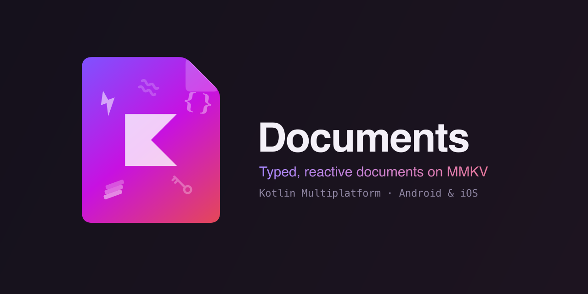

<div align="center">
  
</div>

[](https://github.com/nomemmurrakh/documents/actions/workflows/gradle.yml)
[](LICENSE)
[](https://kotlinlang.org)
[](https://documents.nomemmurrakh.com/platform-support.html)

A document-oriented Kotlin Multiplatform storage library backed by
[MMKV](https://github.com/Tencent/MMKV). Define a data class, treat it as a document, and get
typed reads, copy-style updates, and `Flow` reactivity.

```kotlin
@Serializable
data class Note(val title: String = "", val body: String = "", val done: Boolean = false)

val note = Documents.document<Note>("note-1")   // one call, you have a document

note.set(Note(title = "Pick up milk", body = "2%, not whole"))
note.update(Note::done, true)   // one field, no read
note.flow().collect { editor.render(it) }   // the editor reacts to every write
```

That's the whole story. No schema, no DAO, no `MMKV.initialize`, no serialization plumbing.

### 📖 [Read the full documentation →](https://documents.nomemmurrakh.com)

Installation, quick start, guides, use cases, concepts, benchmarks, and the full API reference all
live there.

> [!NOTE]
> **What's new in v0.2.0**
>
> Version 0.2.0 makes it safe to open the same document in more than one place. In v0.1.0, a
> write was only seen by the instance that made it, so every part of an app had to share a single
> instance. That is no longer needed.
>
> - **Instances stay in sync.** A write through one instance now reaches `flow()`, `stateFlow()`,
>   and `fieldFlow()` on every other instance of the same document. This holds whether the
>   instances come from dependency injection, from repeated `Documents.document(...)` calls, or
>   from separate `Documents.collection(name)` calls.
> - **Updates are not lost.** If two instances of the same document call `update` at the same
>   time, both changes are applied one after the other.
> - **Nothing to change in your code.** The public API is the same as in v0.1.0.
>
> See [Opening Documents](https://documents.nomemmurrakh.com/guide/opening-documents.html) for
> details.

---

## Platform support

| Platform | Status | Storage engine |
| -------- | :----: | -------------- |
| Android  | ✅ | MMKV |
| iOS (`arm64` and `simulatorArm64`) | ✅ | MMKV |

> [!NOTE]
> **How the library is configured.** On Apple targets, MMKV is bound through the Kotlin CocoaPods
> plugin.

Both platforms share one public API, and all of it lives in `commonMain`. On both platforms the
library initializes MMKV itself, so you have nothing to set up for it.

## Try the sample

A runnable Compose Multiplatform sample lives in [`sample/`](sample/). It runs on both Android and
iOS, and it is made of three parts:

- [`sample/shared/`](sample/shared/): one shared UI that runs natively on both platforms.
- [`sample/androidApp/`](sample/androidApp/): the Android app.
- [`sample/iosApp/`](sample/iosApp/): the iOS app.

It has a screen for each documented
[use case](https://documents.nomemmurrakh.com/use-cases/index.html):

- **Settings & Preferences:** typed, observable app settings.
- **Session & User State:** signing in and out, with real field-level encryption for the auth
  token.
- **Caches & Drafts:** a draft that survives a relaunch.
- **Reactive UI State:** a simulated download that drives a live progress bar.
- **Shared KMP Persistence:** an offline queue, with the same code on both platforms.

Clone the repository, run it, and tap through it on either platform.

## Roadmap

- Rich error messages to differentiate causes
- ~~IDE plugin to view MMKV files as collections & documents~~ Done in
  [Documents Inspector](https://github.com/nomemmurrakh/documents-inspector) v0.1.0.
- Add Desktop target support
- Add Web target support

## Built with Documents


**[PetCare](https://petcare.nomemmurrakh.com)** is a pet care app for Android. It tracks pet health
and fitness data and gives weekly AI-generated suggestions. PetCare is my own app, and it is in
closed testing right now.

PetCare uses Documents in production, with one collection for each kind of data:

- **`settings`:** app preferences such as theme, weight units, haptics, whether the AI chat
  disclosure was acknowledged, and analytics consent. The UI collects the document's `flow()`, so
  a change shows up everywhere right away.
- **`session`:** the access and refresh tokens. A `FieldDecorator` encrypts them with AES-GCM, and
  the key is protected by the Android Keystore. Signing out only deletes the document. Other parts
  of the app collect its `flow()` and react: one resets account-specific settings, and another
  tells the server and unregisters the push token.
- **`analytics_profile`:** the user id and how the user signed up, kept for analytics.
- **`lifecycle_progress`:** how far the user has come: signed up, added a pet, logged for the
  first time, or become an active logger. It also keeps the recent days they logged and whether
  they have used the AI chat.

It also shows two patterns:

- **Recovering from bad data.** If a stored document cannot be decoded, PetCare catches the
  `DocumentDecodingException`, deletes the document, and starts again from the defaults.
- **Testing.** Its stores take a `Collection`, so tests pass in `Documents.inMemory()` and need no
  device.

## License

See [LICENSE](LICENSE).

---

If you find `Documents` useful, consider giving the repo a ⭐. It helps others discover it.
